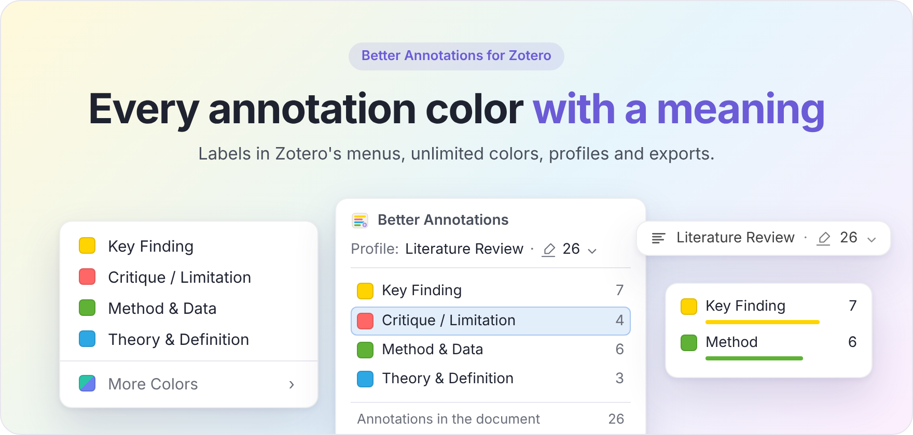
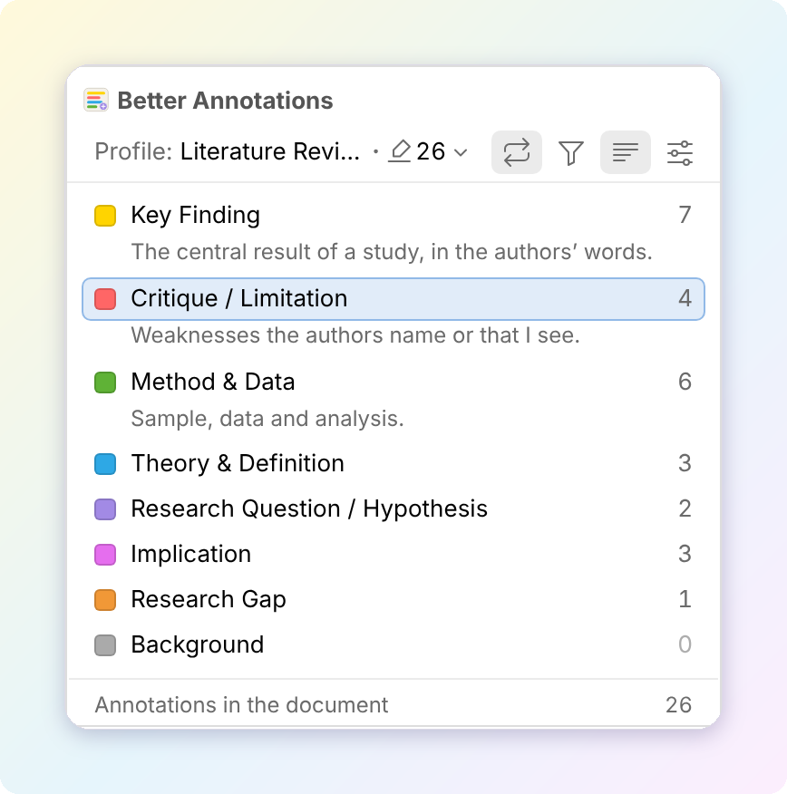
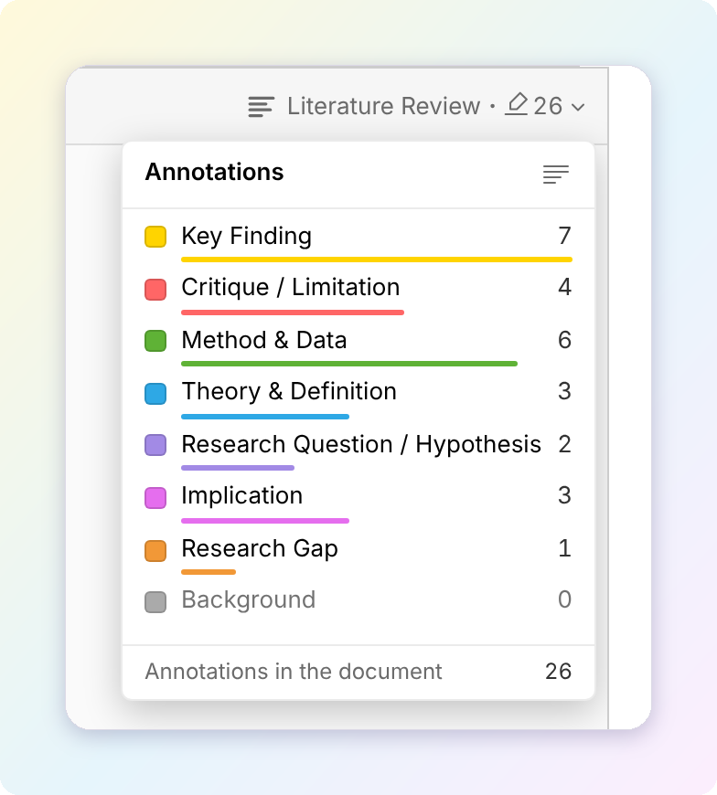
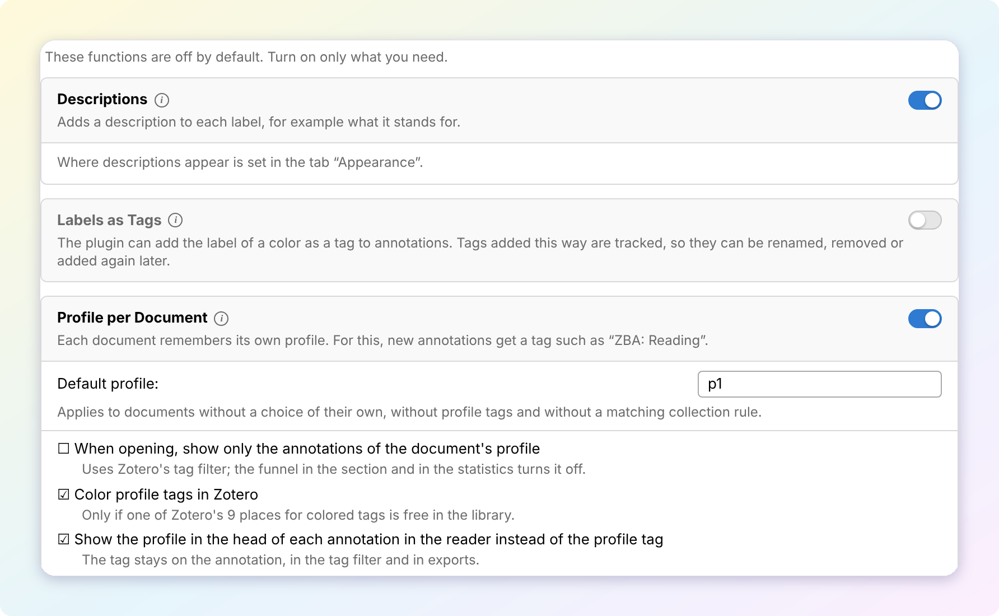
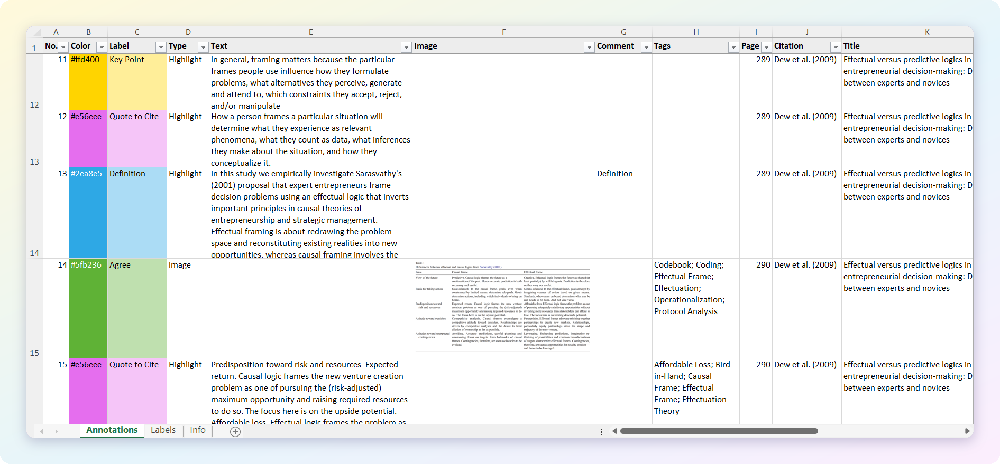

<div align="center">



<p>
<a href="https://github.com/CorsiQa/zotero-better-annotations/releases/latest"></a>
<a href="https://github.com/CorsiQa/zotero-better-annotations/releases"></a>
<a href="#compatibility"></a>
<a href="#compatibility"></a>
<a href="#features"></a>
<a href="#license-and-credits"></a>
</p>

<p>
<a href="https://github.com/CorsiQa/zotero-better-annotations/releases/latest"><b>Download</b></a> &nbsp;·&nbsp;
<a href="#features">Features</a> &nbsp;·&nbsp;
<a href="#installation">Installation</a> &nbsp;·&nbsp;
<a href="#faq">FAQ</a> &nbsp;·&nbsp;
<a href="docs/README.md">Documentation</a> &nbsp;·&nbsp;
<a href="docs/README.de.md">Dokumentation (DE)</a>
</p>

</div>

**At a glance**

- 🏷️ **A label for every annotation color**, right where you pick a color in Zotero's reader.
- 🎨 **As many colors as you need**, in your order, saved as **profiles** you can switch.
- 📌 **A section in the item pane** to pick colors, count annotations and drag colors onto highlights.
- 🧪 **Optional advanced functions** (descriptions, labels as tags, a profile per document) that make coding, qualitative analysis and structured literature reviews possible.
- 📤 **Export** to Excel, CSV and HTML, with labels. Every change to annotations can be undone.
- 🆓 Free and open source, Zotero 7 to 10, 11 languages. ⏱️ [Install in a minute](#installation).

> [!NOTE]
> **Beta.** Better Annotations works in daily use, but has not yet been tested widely. Please back up your Zotero data directory before you try it and [report problems](https://github.com/CorsiQa/zotero-better-annotations/issues/new?template=bug_report.yml).

Zotero offers eight annotation colors without names, so it is easy to forget which color stands for what. Better Annotations gives every color a label that appears wherever you choose a color, lets you add as many colors as you need and keeps several color sets as profiles. Most people use it to mark findings, methods or open questions while reading. Turned on in the settings, the advanced functions go further: a label can stand for any category, including a code, a document can keep its own scheme, and the export lists every annotation with its label.

<a name="features"></a>

## &nbsp;Features


### 🏷️ Labels where you choose a color

The label of a color appears wherever Zotero lets you pick one, so you see what a color means while you read.

🖱️ **Context menu and toolbar.** Right-click an annotation or open the color menu of the toolbar: every color shows its label. Colors beyond the first eight move into a submenu.

✨ **Selection popup.** After selecting text, hover a color to see its label and its description.

🔎 **Sidebar filter.** The color filter of the annotation sidebar names the colors as well.

🛡️ **Robust next to other plugins.** If another plugin for annotation colors is active, the settings point it out once and offer to take over its labels.

<br clear="all">


### 🎨 Colors and profiles

Add, rename, hide and reorder colors, and keep different sets for different work.

➕ **Any number of colors.** Pick colors with the color picker, from palettes or by hex code, and drag them into your order.

🗂️ **Profiles.** Keep one set for reading and another one for a review. Switch in the reader, in the item pane or in the settings. Your annotations keep their colors; only the labels change.

📚 **Template library.** Start from schemes such as Literature Review (TCCM, ADO), Toulmin's argument analysis, the paradigm model of Grounded Theory, PICO or a reading workflow.

🔁 **Share.** Export a profile as a file and import the profiles of colleagues.

<br clear="all">



### 📌 Item pane section and separate window

A section next to the reader lists the labels of the document's profile with the number of annotations.

👆 **Click to annotate.** A click on a label starts highlighting in its color. With text or annotations selected, the click colors them once.

🖐️ **Drag and drop.** Drag a color onto an annotation in the sidebar, onto a highlight in the PDF or onto selected text.

🪟 **Separate window.** Open the list in its own window, for example on a second screen. It follows the active reader tab.

📝 **Descriptions at hand.** Show what each label stands for right below it.

<br clear="all">



### 📊 Reader toolbar and statistics

One button in the reader toolbar shows the profile of the document and how many annotations it has.

🔀 **Switch profiles.** A click opens the profile menu.

📈 **Statistics.** Hover the button to see the annotations per label, grouped by profile.

🎯 **One profile at a time.** The filter shows only the annotations of the document's profile, in the list and in the document.

↔️ **Tools in the middle.** Zotero's tools stay above the middle of the document, however long the profile name is.

<br clear="all">



### 🧪 Advanced functions for coding and reviews

Three functions are off by default. They write to your library or need a short explanation, so you turn them on under **Advanced** when you need them.

📝 **Descriptions.** Define what each label means and when to use it, like the definition of a code. Descriptions appear in tooltips, the item pane, the statistics and the export.

🏷️ **Labels as tags.** Annotations receive the label of their color as a tag, so you can search and filter them across your library. The plugin keeps track of its tags and can rename or remove them.

📄 **Profile per document.** Every document keeps its own profile, chosen by hand, by its annotations or by rules for collections. A profile tag records which scheme an annotation belongs to, so several schemes can live in one document.

<br clear="all">



### 📤 Export

Export the annotations of a document, a collection or a library with one row per annotation.

📗 **Excel.** Colored cells, images, grouped columns that fold, a sheet with all labels and their descriptions, and links that open each annotation in Zotero.

📄 **CSV.** For R, Python, SPSS and other software, in UTF-8.

🌐 **HTML.** A readable report grouped by source or by label, to print or save as PDF.

🧭 **Your selection.** Choose the area, the order, the profile and the columns.

<br clear="all">

### ✨ Everything else, in one line each

| | |
|---|---|
| 🎨 **Recolor and merge** | Change the color of existing annotations in a document, the selected items, a collection or a whole library. |
| 💾 **Backups** | The colors of all annotations are saved when the plugin starts for the first time. |
| ↩️ **History** | Every change the plugin makes to annotations is listed and can be undone. |
| 🧳 **Full backup** | Moves all profiles, settings and the history to another computer. |
| 🎛️ **Appearance** | Choose where labels, descriptions and buttons appear, and how the selection popup is arranged. |
| 🌍 **11 languages** | English, Deutsch, Español, Français, Italiano, 日本語, Polski, Português, Русский, 简体中文, 繁體中文. |
| 🔄 **Updates** | Zotero installs new versions automatically; the settings show whether you have the latest one. |

<a name="installation"></a>

## &nbsp;Installation

1. Download `better-annotations-<version>.xpi` from the [latest release](https://github.com/CorsiQa/zotero-better-annotations/releases/latest) (in Firefox: right-click → Save Link As).
2. In Zotero, open **Tools → Plugins**.
3. Drag the file into the window, or click the gear icon and choose **Install Plugin From File…**.

Zotero installs future versions automatically.

> [!NOTE]
> The plugin never changes existing annotations without asking. Your annotations keep their colors after installation.

<a name="quick-start"></a>

## &nbsp;Quick start

1. Open **Edit → Settings** (macOS: **Zotero → Settings**) and choose **Better Annotations**.
2. Type a label next to each color, or click **Browse Templates** and start from a template.
3. Click **Save**.
4. Open a PDF. The section **Better Annotations** appears in the item pane on the right. Click a label and select text, or select text and pick a color in the popup.

To give documents their own schemes, turn on **Profile per Document** under **Advanced**. The [documentation](docs/README.md) explains every setting.

<a name="faq"></a>

## &nbsp;Frequently asked questions

**Labels and colors**

<details>
<summary><b>How do I rename or label the highlight colors in Zotero?</b></summary>
<br>

Zotero itself does not offer this. Open the settings of Better Annotations and type a label next to each color. The labels then appear in the reader's menus, in the selection popup, in the sidebar filter and in the item pane section.
</details>

<details>
<summary><b>How do I get more colors or my own colors?</b></summary>
<br>

Click **Add Color** and choose any color with the color picker, from a palette or by hex code. There is no fixed limit. Colors beyond the first eight appear in a submenu of the context menu and in further rows of the selection popup. Colors you do not need right now can be hidden.
</details>

<details>
<summary><b>Another plugin for annotation colors is installed. What should I do?</b></summary>
<br>

Highlight Color Descriptions, Annotation Color Customizer and Just Enough Color change the same menus, so labels can appear twice or wrong. The settings of Better Annotations show a notice while one of them is active and offer to take over its labels as a profile. Then disable the other plugin under **Tools → Plugins**.
</details>

**Profiles and advanced functions**

<details>
<summary><b>What is the difference between the active profile and “Profile per Document”?</b></summary>
<br>

Without “Profile per Document”, one profile applies to all documents. Switching it changes the labels everywhere. With the function turned on, every document keeps its own profile: the one you last chose in it, otherwise the profile of most of its annotations, a rule for its collection or the default profile.
</details>

<details>
<summary><b>What are the tags “ZBA: …” on my annotations?</b></summary>
<br>

With “Profile per Document”, each new annotation gets a profile tag such as “ZBA: Literature Review”. It records which scheme the annotation belongs to, so the same color can mean different things in different profiles, and it syncs with your library. The reader hides the tag in the annotation and shows the profile name in its head instead. Turning the function off asks whether the tags stay; renaming or deleting a profile updates them.
</details>

<details>
<summary><b>Why does an annotation count as “Standard” or “No profile”?</b></summary>
<br>

With “Profile per Document”, only the profile tag puts an annotation into a profile. Annotations without a tag count as “Standard” if they have one of Zotero's eight colors, otherwise as “No profile”. **Assign** in the item pane gives them the tag of the document's profile.
</details>

<details>
<summary><b>Can I use the plugin for coding, qualitative analysis or a literature review?</b></summary>
<br>

Yes. A label can stand for any category, including a code; descriptions hold the definition of each code; labels as tags make coded passages searchable across the library; a profile per document lets several schemes live side by side; and the export lists all annotations with their labels, like a list of coded segments. The template library has schemes for reviews and analysis. Better Annotations does not replace software such as MAXQDA or NVivo: it has no code hierarchy, memos or intercoder agreement. Its exports can be processed further in other software.
</details>

<details>
<summary><b>How can my team use the same labels in a group library?</b></summary>
<br>

Profiles are stored on each computer. Export your profile and let colleagues import it. Tags (labels as tags, profile tags) are part of the group library, so every member sees them.
</details>

**Backup, sync and export**

<details>
<summary><b>Does the plugin change my existing annotations?</b></summary>
<br>

Only when you ask it to, for example when you recolor annotations, add tags or assign profiles. It asks first, records the change in the history and can undo it. On first start it saves the colors of all annotations.
</details>

<details>
<summary><b>How do I undo a change or go back to the state before installation?</b></summary>
<br>

Under **Library → History**, **Undo…** reverts a single change. Under **Library → Backups**, **Restore…** sets the colors back to a backup, for example the one “before installation”, and removes the plugin's tags. Annotations created later and your own tags stay unchanged.
</details>

<details>
<summary><b>Are my profiles synced between computers?</b></summary>
<br>

Not by Zotero sync. Annotations and their tags sync as usual, but profiles and settings stay on the computer. Use **Create Full Backup…** on one computer and **Load Full Backup…** on the other, or export single profiles.
</details>

<details>
<summary><b>How do I export annotations to Excel or CSV, or group them by color?</b></summary>
<br>

Open the **Export** tab, choose the area, the format and the order. Each annotation becomes one row with label, text or image, comment, tags, page, source and a link back to Zotero. Ordered by label, the Excel file can be filtered by label and the HTML report groups all annotations under their labels.
</details>

<details>
<summary><b>What happens when I uninstall the plugin?</b></summary>
<br>

Your annotations keep their colors, and tags stay on them. Remove plugin tags first with **Remove Plugin Tags…** if you do not want to keep them. The folder `better-annotations` in your Zotero data directory stays, so a later installation finds your profiles again.
</details>

<details>
<summary><b>Does the plugin send data anywhere?</b></summary>
<br>

No. The only network access is Zotero's own update check.
</details>

<a name="compatibility"></a>

## &nbsp;Compatibility

| Zotero | Status |
|---|---|
| 10 | Tested |
| 7 to 9 | Supported, not yet tested. Reports are welcome. |

Some plugins change the same menus or the selection popup:

| Plugin | What to expect |
|---|---|
| [Highlight Color Descriptions](https://github.com/paulMrG2/zotero-highlight-descriptions), [Annotation Color Customizer](https://github.com/aidecameron/zotero-annotation-color-customizer), [Just Enough Color](https://github.com/MCXCC303/just-enough-color) | Rename or add colors in the same menus. Better Annotations shows a notice and offers to take over their labels; then disable them. |
| [Zotero Style](https://github.com/MuiseDestiny/zotero-style) | Has its own editor for annotation color names. Do not use both for annotation colors. |
| [Actions & Tags](https://github.com/windingwind/zotero-actions-tags) | Scripts that rename colors change the same menus, and actions that tag new annotations can add tags twice. Use one of both for these tasks. |
| [Translate for Zotero](https://github.com/windingwind/zotero-pdf-translate) | No conflict. Choose a popup layout under **Appearance** if the popup gets crowded. |

<a name="development"></a>

## &nbsp;Development

To be open about it: Better Annotations is largely vibe-coded. The maintainer describes what the plugin should do, decides on the design and tests every version in Zotero; the code itself is written by the AI assistant Claude (Anthropic). The translations were made the same way.

The project follows a UX-first approach: every function should feel like part of Zotero, follow Zotero's conventions and stay accessible by keyboard. At the same time, the plugin aims at a wide range of functions and a high degree of customization, with advanced functions that stay out of the way until you turn them on. All functions are tested as thoroughly as possible, with automated tests in a simulated Zotero and by hand in Zotero itself, and refined over many rounds of feedback.

Help is welcome:

- 🧪 **Testing:** try the plugin in your own workflow and on Zotero 7, 8 or 9, and [report](https://github.com/CorsiQa/zotero-better-annotations/issues/new?template=bug_report.yml) what works and what does not.
- 🌍 **Languages:** suggestions for better wording in any language are welcome, as an issue or a pull request ([how to](CONTRIBUTING.md#translations)).
- 💡 **Ideas:** [suggest a feature](https://github.com/CorsiQa/zotero-better-annotations/issues/new?template=feature_request.yml) or join the [Discussions](https://github.com/CorsiQa/zotero-better-annotations/discussions).

<a name="for-developers"></a>

## &nbsp;For developers

The plugin is plain JavaScript and runs in Zotero without a build step. [CONTRIBUTING.md](CONTRIBUTING.md) describes the files, translations, versions and the release process.

```
node scripts/build.mjs           # builds dist/better-annotations-<version>.xpi and dist/updates.json
node scripts/check-locales.mjs   # checks that all languages have the same strings
```

Releases are built by GitHub Actions when a release is published on GitHub; the action attaches the `.xpi` file and `updates.json`, from which Zotero learns about new versions. A second action raises the supported Zotero version without a new release.

<a name="license-and-credits"></a>

## &nbsp;License and credits

Copyright © 2026 CorsiQa.

[GNU Affero General Public License v3.0 or later](LICENSE). You may use, share and change the plugin; changed versions that you distribute must be published under the same license. The name Better Annotations and its logo are not covered by the AGPL license. Please do not use them for other projects without permission.

Zotero is a registered trademark of the [Corporation for Digital Scholarship](https://digitalscholar.org). This plugin is an independent project and not affiliated with Zotero.

If the plugin helps your research, you can cite it with the information in [CITATION.cff](CITATION.cff) or the “Cite this repository” button on GitHub.

Thanks to the authors of these plugins, which Better Annotations builds on:

- [Just Enough Color](https://github.com/MCXCC303/just-enough-color) by MCXCC303: the method for creating annotations in arbitrary colors is adapted from this plugin (AGPL-3.0-or-later); the functions in `content/reader.js` say so.
- [Zotero Highlight Color Descriptions](https://github.com/paulMrG2/zotero-highlight-descriptions) by paulMrG2: the idea of showing labels in the reader's color menus.
- [Annotation Color Customizer](https://github.com/aidecameron/zotero-annotation-color-customizer) by aidecameron: the idea of renaming annotation colors.
