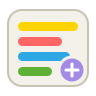
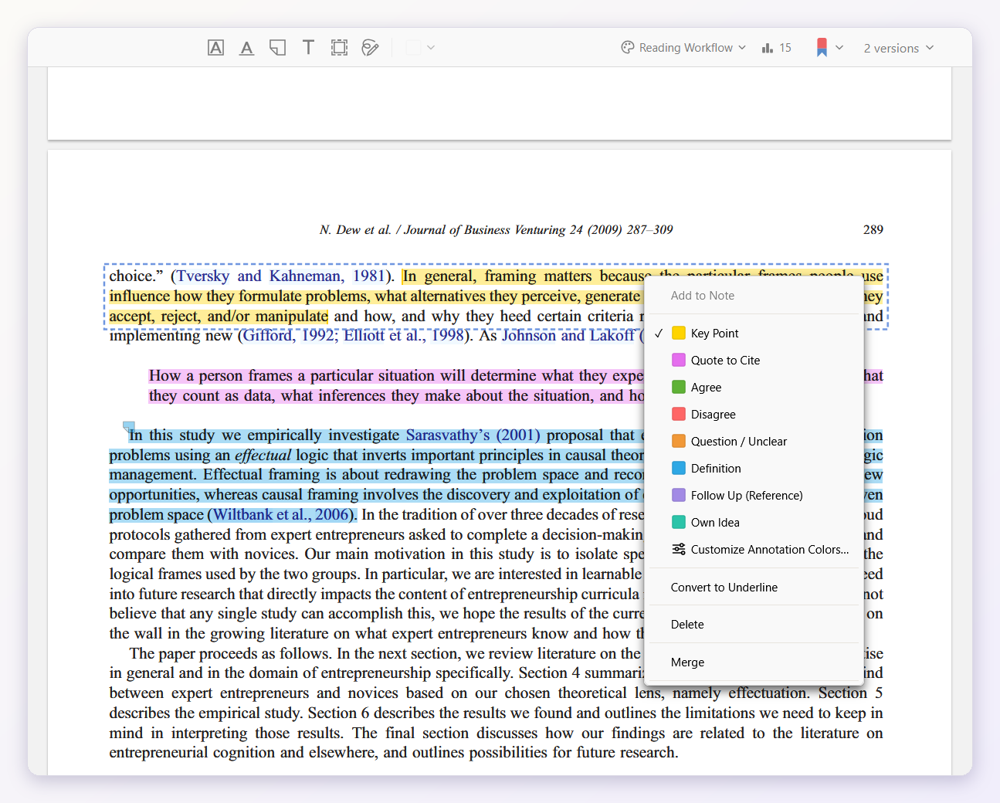
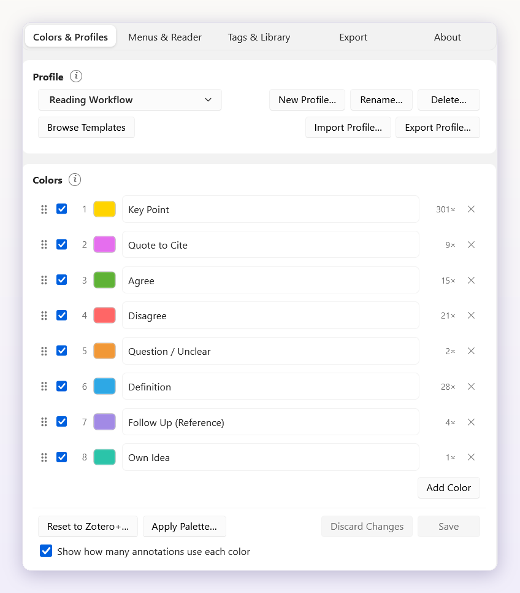
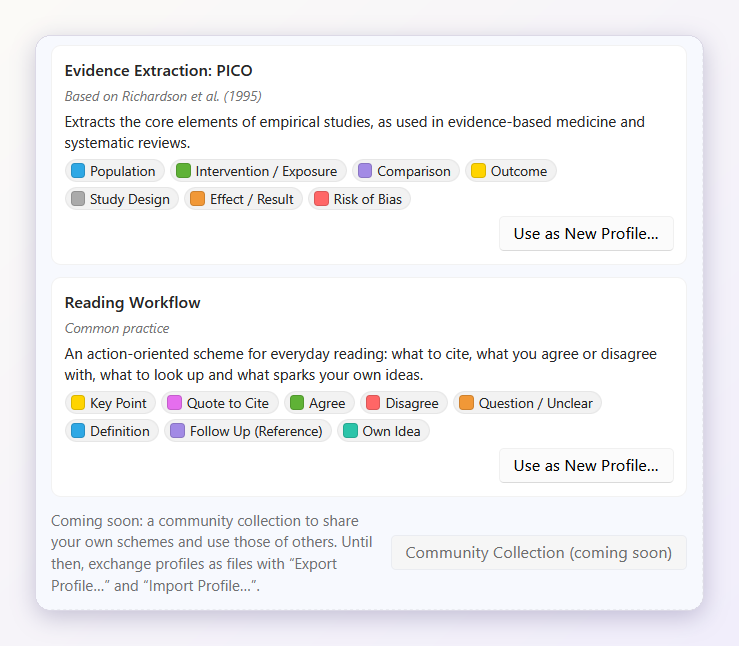
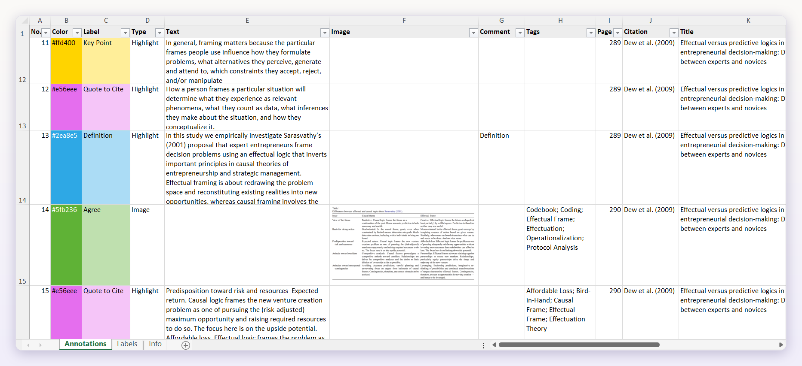

<div align="center">



# Better Annotations for Zotero

<p><b>Name and extend annotation colors, switch color profiles and export annotations.</b></p>

<p>
<a href="https://github.com/CorsiQa/zotero-better-annotations/releases/latest"></a>
<a href="https://github.com/CorsiQa/zotero-better-annotations/releases"></a>
<a href="#compatibility"></a>
<a href="#compatibility"></a>
<a href="#features"></a>
<a href="LICENSE"></a>
</p>

<p>
<a href="https://github.com/CorsiQa/zotero-better-annotations/releases/latest"><b>Download</b></a> &nbsp;·&nbsp;
<a href="#features">Features</a> &nbsp;·&nbsp;
<a href="#installation">Installation</a> &nbsp;·&nbsp;
<a href="#faq">FAQ</a> &nbsp;·&nbsp;
<a href="docs/README.md">Documentation</a> &nbsp;·&nbsp;
<a href="docs/README.de.md">Dokumentation (DE)</a>
</p>

<br>



</div>

> [!NOTE]
> **Beta.** This is the first public version. It works in daily use but has not yet been tested widely. Please back up your Zotero data directory before you try it and [report problems](https://github.com/CorsiQa/zotero-better-annotations/issues/new?template=bug_report.yml).

Better Annotations is a free plugin for [Zotero](https://www.zotero.org) 7 and later. Zotero offers eight annotation colors without names, so it is easy to forget which color stands for what. Better Annotations gives every color a label that appears wherever you choose a color, lets you add as many colors as you need and keeps several color sets as profiles. Optional tools turn labels into tags, recolor existing annotations and export annotations with their labels.

<a name="features"></a>

## &nbsp;Features

Click a feature to see the details.

<details>
<summary> <b>Labels for colors</b> · see what each color means while you read</summary>
<br>

Every color gets a label, such as “Key Point”, “Definition” or “Method”. The labels appear in the context menu of an annotation, in the color menu of the reader toolbar, as tooltips in the popup that opens when you select text and in the color filter of the annotation sidebar. Colors without a label stay hidden in the menus.

</details>

<details>
<summary> <b>More colors, any order</b> · add, remove, hide and rearrange colors</summary>
<br>

Use any number of colors in any color you like. Reorder them by drag and drop, hide colors you do not need right now, and choose colors from example palettes or recently used colors. Colors beyond the first eight move into a “More Colors” submenu, so the context menu stays short.



</details>

<details>
<summary> <b>Profiles</b> · keep several color sets and switch between them</summary>
<br>

A profile stores a complete set of colors, labels and order, for example one for literature work and one for reviewing manuscripts. Switch profiles in the settings or directly in the reader toolbar. Export a profile as a file to share it with colleagues, or import theirs. Switching profiles never changes your annotations, only the labels shown for them.

</details>

<details>
<summary> <b>Template library</b> · start from ready-made profiles</summary>
<br>

Templates provide starting points based on established frameworks and common reading routines, for example PICO for extracting evidence or a reading workflow with labels such as “Quote to Cite” and “Follow Up”. Using a template creates a new profile that you can change freely.



</details>

<details>
<summary> <b>Statistics</b> · count annotations per label in the open document</summary>
<br>

A button in the reader toolbar shows how many annotations the open document has. Hover over it to see the number per label.

</details>

<details>
<summary> <b>Labels as tags</b> · tag annotations automatically by color (optional)</summary>
<br>

When enabled, new annotations and annotations whose color you change receive the label of their color as a tag, optionally with a prefix. The plugin keeps track of the tags it added, so it can rename them when you rename a label and remove them again without touching your own tags.

</details>

<details>
<summary> <b>Recolor and merge</b> · change the color of existing annotations</summary>
<br>

Change all annotations of one color to another color, for example to merge two categories or to move to a new palette. Choose where the change applies: the open document, the selected items, a collection, its parent collection, a library or all libraries.

</details>

<details>
<summary> <b>Export</b> · annotations to Excel, CSV or HTML</summary>
<br>

Export the annotations of a document, collection or library with one row per annotation: color, label, type, text, comment, tags, page, source and a link that opens the annotation in Zotero. Excel files contain colored cells and the images of image annotations; HTML files are a readable report grouped by source or label; CSV files suit R, Python or SPSS.



</details>

<details>
<summary> <b>Backups and undo</b> · every change can be reversed</summary>
<br>

The plugin saves the colors of all annotations when it starts for the first time. Every change it makes to annotations asks for confirmation first and appears in a history where you can undo it. A full backup moves all profiles, settings and history to a new computer.

</details>

<details>
<summary> <b>13 languages</b> · follows the language of Zotero</summary>
<br>

English, Deutsch, Español, Français, Italiano, 日本語, Norsk bokmål, Polski, Português, Русский, Svenska, 简体中文, 繁體中文. The language can be changed in the plugin settings.

</details>

<a name="installation"></a>

## &nbsp;Installation

1. Download `better-annotations-<version>.xpi` from the [latest release](https://github.com/CorsiQa/zotero-better-annotations/releases/latest) (in Firefox: right-click → Save Link As).
2. In Zotero, open **Tools → Plugins**.
3. Drag the file into the window, or click the gear icon and choose **Install Plugin From File…**.

Zotero installs future versions automatically.

> [!NOTE]
> The plugin never changes existing annotations without asking. Your annotations keep their colors after installation.

<a name="quick-start"></a>

## &nbsp;Quick start

1. Open **Edit → Settings** (macOS: **Zotero → Settings**) and choose **Better Annotations**.
2. Type a label next to each color, or open **Browse Templates** and start from a template.
3. Click **Save**.
4. Open a PDF, select text and pick a color. Hover over a color to see its label.

The [documentation](docs/README.md) explains every setting.

<a name="faq"></a>

## &nbsp;Frequently asked questions

<details>
<summary><b>How can I rename or label the highlight colors in Zotero?</b></summary>
<br>

Zotero itself does not offer this. With Better Annotations, open the plugin settings and type a label next to each color. The labels then appear in the reader instead of names like “Yellow”, so you no longer have to remember which color means what.
</details>

<details>
<summary><b>Can I see what a color means while I am reading?</b></summary>
<br>

Yes. The labels appear in the context menu of an annotation and in the color menu of the toolbar. In the popup after selecting text, hovering over a color shows its label.
</details>

<details>
<summary><b>How do I get more highlight colors or my own custom colors?</b></summary>
<br>

Click **Add Color** in the settings and choose any color with the color picker or a hex code. There is no fixed limit. Colors beyond the first eight appear in a submenu of the context menu and in further rows of the selection popup.
</details>

<details>
<summary><b>Can I use different color schemes for different projects?</b></summary>
<br>

Yes. Save each scheme as a profile and switch profiles in the reader toolbar. Annotations keep their colors; only the labels shown for them change.
</details>

<details>
<summary><b>Can Zotero tag my annotations automatically based on their highlight color?</b></summary>
<br>

Yes, with the option “Add labels as tags”. New and recolored annotations then receive the label of their color as a tag, so you can filter and search them across your library. Existing annotations can be tagged in one step.
</details>

<details>
<summary><b>How do I export Zotero annotations to Excel or CSV, one row per annotation?</b></summary>
<br>

Open the **Export** tab, choose a document, collection or library and the format. Each annotation becomes one row with color, label, text, comment, tags, page, source and a link back to Zotero.
</details>

<details>
<summary><b>Can I extract or group annotations by color?</b></summary>
<br>

Export them sorted by label: the Excel file can then be filtered by color or label, and the HTML report groups all annotations under their labels. Within a document, Zotero's own color filter in the annotation sidebar shows one color at a time.
</details>

<details>
<summary><b>Can I use the colors as codes for qualitative analysis or a literature review?</b></summary>
<br>

Yes. A label can stand for any category, including a code. The template library contains schemes based on established review and analysis frameworks, and the export lists all annotations with their labels, similar to a list of coded segments.
</details>

<details>
<summary><b>How can my team use the same color meanings in a group library?</b></summary>
<br>

Labels are stored on each computer. Export your profile and let colleagues import it. With the tag option enabled, the labels are also saved as tags, which every member of the group library can see.
</details>

<details>
<summary><b>Does the plugin change my existing annotations?</b></summary>
<br>

Only when you ask it to, for example when you recolor annotations or apply tags. It asks for confirmation, records the change in a history and can undo it. A backup of all annotation colors is created on first start.
</details>

<details>
<summary><b>Are my labels synced between computers?</b></summary>
<br>

Not by Zotero sync. Use **Create Full Backup…** on one computer and **Load Full Backup…** on the other.
</details>

<details>
<summary><b>Does the plugin send data anywhere?</b></summary>
<br>

No. The only network access is Zotero's own update check.
</details>

<a name="compatibility"></a>

## &nbsp;Compatibility

| Zotero | Status |
|---|---|
| 10 | Tested |
| 7 to 9 | Supported, not yet tested. Reports are welcome. |

Some plugins change the same menus or the selection popup. If something looks wrong, disable them one by one:

| Plugin | Possible interference |
|---|---|
| [Zotero Highlight Color Descriptions](https://github.com/paulMrG2/zotero-highlight-descriptions) | Labels the same color menus. Disable it; Better Annotations imports its labels on first start. |
| [Annotation Color Customizer](https://github.com/aidecameron/zotero-annotation-color-customizer) | Renames colors in the same menus. Disable it. |
| [Just Enough Color](https://github.com/MCXCC303/just-enough-color) | Adds its own colors to the selection popup. Disable it. |
| [Zotero Style](https://github.com/MuiseDestiny/zotero-style) | Has its own editor for annotation color names and sets. Do not use both for annotation colors. |
| [Actions & Tags](https://github.com/windingwind/zotero-actions-tags) | Community scripts that rename annotation colors change the same menus, and actions that tag new annotations can add tags twice. Use one of both for these tasks. |
| [Translate for Zotero](https://github.com/windingwind/zotero-pdf-translate) | No conflict. It adds a translation panel to the selection popup; choose a popup layout under **Menus & Reader**. |

<a name="development"></a>

## &nbsp;Development

Better Annotations is developed as a private open-source project. The source code was written with the help of the AI assistant Claude (Anthropic) and is reviewed and tested by the maintainer.

Help is welcome:

- **Testing:** try the features in your own workflow and on Zotero 7, 8 or 9, and [report](https://github.com/CorsiQa/zotero-better-annotations/issues/new?template=bug_report.yml) what works and what does not.
- **Languages:** the translations were made with AI assistance. Suggestions for better wording in any language are welcome, as an issue or a pull request ([how to](CONTRIBUTING.md#translations)).
- **Ideas:** [suggest a feature](https://github.com/CorsiQa/zotero-better-annotations/issues/new?template=feature_request.yml) or join the [Discussions](https://github.com/CorsiQa/zotero-better-annotations/discussions).

<details>
<summary>Build and release</summary>
<br>

```
node scripts/build.mjs           # builds dist/better-annotations-<version>.xpi and dist/updates.json
node scripts/check-locales.mjs   # checks that all languages have the same strings
```

Releases are built by GitHub Actions when a release is published on GitHub. See [CONTRIBUTING.md](CONTRIBUTING.md) for details.

</details>

<a name="license"></a>

## &nbsp;License

Copyright © 2026 CorsiQa.

[GNU Affero General Public License v3.0 or later](LICENSE). You may use, share and change the plugin; changed versions that you distribute must be published under the same license.

Zotero is a registered trademark of the [Corporation for Digital Scholarship](https://digitalscholar.org). This plugin is an independent project and not affiliated with Zotero.

If the plugin helps your research, you can cite it with the information in [CITATION.cff](CITATION.cff) or the “Cite this repository” button on GitHub.

<a name="credits"></a>

## &nbsp;Credits

Thanks to the authors of these plugins, which Better Annotations builds on:

- [Just Enough Color](https://github.com/MCXCC303/just-enough-color) by MCXCC303: the method for creating annotations in arbitrary colors is adapted from this plugin (AGPL-3.0-or-later); the functions in `content/reader.js` say so.
- [Zotero Highlight Color Descriptions](https://github.com/paulMrG2/zotero-highlight-descriptions) by paulMrG2: the idea of showing labels in the reader's color menus.
- [Annotation Color Customizer](https://github.com/aidecameron/zotero-annotation-color-customizer) by aidecameron: the idea of renaming annotation colors.
